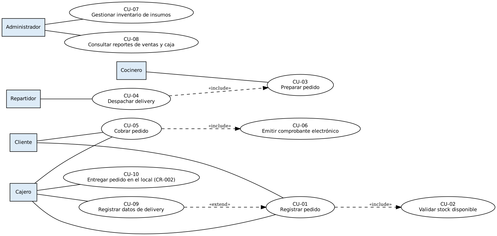

# Casos de uso - Pollería Don Fuego S.A.C. (v1.1)

| ID | Caso de uso | Actores | HU | Pruebas |
|---|---|---|---|---|
| [CU-01](CU-01.md) | Registrar pedido | Cajero (primario), Cliente | HU-01, HU-04, HU-05, HU-15 | PR-01, PR-02, PR-07, PR-08, PR-09, PR-23 |
| [CU-02](CU-02.md) | Validar stock disponible | Cajero | HU-02 | PR-03, PR-04 |
| [CU-03](CU-03.md) | Preparar pedido | Cocinero | HU-06, HU-07 | PR-10, PR-11 |
| [CU-04](CU-04.md) | Despachar delivery | Repartidor | HU-09, HU-10 | PR-13, PR-14 |
| [CU-05](CU-05.md) | Cobrar pedido | Cajero (primario), Cliente | HU-11, HU-13 | PR-15, PR-16, PR-19 |
| [CU-06](CU-06.md) | Emitir comprobante electrónico | Cajero | HU-12 | PR-17, PR-18, PR-23 |
| [CU-07](CU-07.md) | Gestionar inventario de insumos | Administrador | HU-06 | PR-10 |
| [CU-08](CU-08.md) | Consultar reportes de ventas y caja | Administrador | HU-14 | PR-20 |
| [CU-09](CU-09.md) | Registrar datos de delivery | Cajero | HU-03, HU-15 | PR-05, PR-06, PR-21, PR-22 |
| [CU-10](CU-10.md) | Entregar pedido en el local | Cajero | HU-08 | PR-12, PR-24 |
